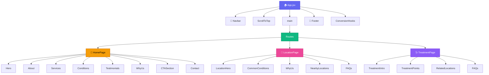

# Restore-Physio Architecture Visualization

## Navigation Index

| Node | Description | File |
|------|-------------|------|
| 🏠 App | Root component | [App.md](#app-structure) |
| 🏡 Home | Homepage | [HomePage.md](#homepage-structure) |
| 📍 Location | Location pages | [LocationPage.md](#locationpage-structure) |
| 🩺 Treatment | Treatment pages | [TreatmentPage.md](#treatmentpage-structure) |
| 🧭 Navbar | Navigation | [Navbar.md](#navbar-structure) |
| 👣 Footer | Footer | [Footer.md](#footer-structure) |
| 📊 Data | Data layer | [DataLayer.md](#data-layer) |

---

## 1. Component Tree (Memory Graph)



---

## 🏠 App Structure

**File:** [src/App.jsx](src/App.jsx)

### Imports
```javascript
import { Routes, Route } from "react-router-dom";
import Navbar from "./components/layout/Navbar";
import Footer from "./components/layout/Footer";
import ConversionHooks from "./components/ui/ConversionHooks";
import ScrollToTop from "./components/utils/ScrollToTop";
import HomePage from "./pages/HomePage";
import LocationPage from "./pages/LocationPage";
import TreatmentPage from "./pages/TreatmentPage";
```

### Routes Table
| Path | Component | Purpose |
|------|-----------|---------|
| `/` | HomePage | Landing page with all sections |
| `/physiotherapy-in-powai` | LocationPage | Powai branch page |
| `/physiotherapy-in-vikhroli` | LocationPage | Vikhroli branch page |
| `/physiotherapy-in-hiranandani` | LocationPage | Hiranandani branch page |
| `/back-pain-treatment-powai` | TreatmentPage | Back pain treatment |
| `/sports-injury-rehab-mumbai` | TreatmentPage | Sports injury rehab |
| `/knee-pain-physio-powai` | TreatmentPage | Knee pain physio |
| `*` | HomePage | Redirect unknown routes |

---

## 🏡 HomePage Structure

**File:** [src/pages/HomePage.jsx](src/pages/HomePage.jsx)

### Sections Order
1. Hero - Main CTA
2. About - Clinic credentials
3. Services - Treatment types
4. Conditions - Conditions treated
5. Testimonials - Patient reviews
6. WhyUs - Differentiators
7. CTASection - Conversion CTA
8. Contact - Contact form

### SEO Schema
- Type: `MedicalBusiness`
- Name: Adapt Physiotherapy
- Phone: +917738556911
- Email: adaptrehabilitation@gmail.com
- Address: Galleria Shopping Mall, Hiranandani Gardens, Powai

---

## 📍 LocationPage Structure

**File:** [src/pages/LocationPage.jsx](src/pages/LocationPage.jsx)

### Props
| Prop | Type | Source |
|------|------|--------|
| slug | string | Route param |

### Data Source
```javascript
const location = getLocationBySlug(slug); // from locations.js
```

### Sections
| Section | Data Source |
|---------|-------------|
| Hero | location.heroLabel, location.heroHeadlines |
| CommonConditions | location.commonConditions |
| WhyUs | location.whyChooseHeading, location.whyChoosePoints |
| NearbyLocations | location.nearbyLocationLinks |
| FAQs | location.faqs |
| Contact | location.phone, location.fullAddress |

### SEO Schema
- Type: `LocalBusiness` + `MedicalBusiness`
- Review schema included
- FAQPage schema for FAQs

---

## 🩺 TreatmentPage Structure

**File:** [src/pages/TreatmentPage.jsx](src/pages/TreatmentPage.jsx)

### Props
| Prop | Type | Source |
|------|------|--------|
| slug | string | Route param |

### Data Source
```javascript
const page = getTreatmentPageBySlug(slug); // from contentPages.js
```

### Structure
| Section | Data |
|---------|------|
| Hero | page.heading, page.intro |
| Points | page.points[] |
| RelatedLocations | page.relatedLocations[] |
| FAQs | treatmentFaqs[] |

### SEO Schema
- Type: `MedicalWebPage`
- FAQPage schema included

---

## 🧭 Navbar Structure

**File:** [src/components/layout/Navbar.jsx](src/components/layout/Navbar.jsx)

### State
| State | Type | Purpose |
|-------|------|---------|
| scrolled | boolean | Background blur on scroll |
| mobileOpen | boolean | Mobile menu toggle |

### Links
```javascript
const links = [
  { label: "About", href: "/#about" },
  { label: "Services", href: "/#services" },
  { label: "Conditions", href: "/#conditions" },
  { label: "Testimonials", href: "/#testimonials" },
];
```

### Mobile Menu Behavior
- Full-screen overlay
- Stagger animation on links
- Body scroll lock when open

---

## 👣 Footer Structure

**File:** [src/components/layout/Footer.jsx](src/components/layout/Footer.jsx)

### Contents
- Logo and tagline
- Quick links
- Contact info
- Social links
- Copyright

---

## 📊 Data Layer

**Files:** [src/data/](src/data/)

| File | Purpose | Exports |
|------|---------|---------|
| locations.js | 3 clinic branches | locations[], locationRouteMap, SITE_URL |
| services.js | Treatment services | services[] |
| conditions.js | Medical conditions | conditions[] |
| testimonials.js | Patient reviews | testimonials[] |
| contentPages.js | Treatment pages | treatmentPages[], treatmentFaqs |

### locations.js Structure
```javascript
{
  slug: "powai",
  name: "Powai",
  area: "Hiranandani Gardens, Powai",
  fullAddress: "Galleria Shopping Mall...",
  phone: "+91 77385 56911",
  geo: { lat: 19.1176, lng: 72.906 },
  mapEmbed: "https://www.google.com/maps/embed...",
  heroLabel: "...",
  heroHeadlines: ["Expert Physiotherapy", "in Powai,", "Mumbai."],
  metaTitle: "...",
  metaDescription: "...",
  commonConditions: [...],
  faqs: [...],
  review: {...}
}
```
